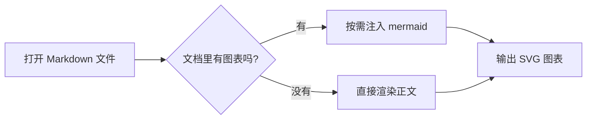

# MD Viewer 语法示例

本文档覆盖 MD Viewer 支持的全部语法，既作为使用示例，也用于渲染验收。

[[toc]]

## 基础排版

**加粗**、*斜体*、~~删除线~~、`行内代码`，以及自动链接 https://wxt.dev 与 [外部链接](https://developer.chrome.com/docs/extensions)。

表情符号短名会被转换为 Unicode 字符：:sparkles: :rocket: :tada:

### 上标与下标

质能方程 E = mc^2^，水的化学式 H~2~O，脚注引用见文末[^1]。

### 插入与标记

++这段文字表示插入内容++，==这段文字表示高亮标记==。

### 缩写

*[HTML]: Hyper Text Markup Language
*[CSS]: Cascading Style Sheets

HTML 与 CSS 均支持缩写提示（鼠标悬停可见解释）。

## 复选框

- [x] 页面检测与自动渲染
- [x] 语法插件与数学公式
- [x] 侧边栏目录与图片预览
- [ ] 更多主题皮肤（规划中）

## 表格

| 能力 | 状态 | 说明 |
| --- | --- | --- |
| GFM 表格 | 已支持 | 默认语法 |
| 任务列表 | 已支持 | 渲染为只读复选框 |
| 外链新标签 | 已支持 | http(s) 链接自动 `target=_blank` |

## 代码高亮

```ts
interface PreviewOptions {
  theme: 'auto' | 'light' | 'dark';
  centered: boolean;
}

export function createPreview(options: PreviewOptions): PreviewOptions {
  return { ...options, centered: options.centered ?? true };
}
```

```python
def fib(n: int) -> int:
    a, b = 0, 1
    for _ in range(n):
        a, b = b, a + b
    return a
```

## 数学公式

行内公式：质能方程 $E = mc^2$，欧拉恒等式 $e^{i\pi} + 1 = 0$。

块级公式：

$$
\int_{-\infty}^{\infty} e^{-x^2} \, dx = \sqrt{\pi}
$$

## 流程图与甘特图




```mmd
sequenceDiagram
  participant U as 用户
  participant C as 内容脚本
  participant S as Service Worker
  U->>C: 打开 .md 文件
  C->>S: 请求注入 mermaid
  S-->>C: 注入完成
  C->>C: 渲染图表
```

## 提醒

> [!NOTE]
> 有用的补充信息，读者浏览时应当留意。

> [!TIP]
> 提高效率的小技巧。

> [!IMPORTANT]
> 完成任务所必需的关键信息。

> [!WARNING]
> 需要立即关注的紧急信息。

> [!CAUTION]
> 操作存在风险，请谨慎执行。

::: info
容器写法：`::: info` 也会渲染为信息提醒。
:::

::: tip 自定义标题
容器提醒支持在类型后追加自定义标题。
:::

::: warning
省略标题时只显示彩色边条与内容。
:::

## 定义列表

Markdown
: 一种轻量级标记语言，可通过纯文本表达格式化文档。

MD Viewer
: 浏览器扩展，把 Markdown 文件渲染为阅读视图。

## 引用与分割线

> 打开 md 文件即预览。
>
> —— MD Viewer

---

## 图像媒体预览

点击下面的图片可以放大查看（被链接包裹的图片不会触发放大）：


[](https://github.com/md-reader/md-reader)

## 脚注

[^1]: 脚注内容会集中显示在文档底部，并支持点击回到引用位置。

## 相对链接

同目录下的相对链接（如 `./another.md`）会按浏览器默认规则解析，可继续打开。
